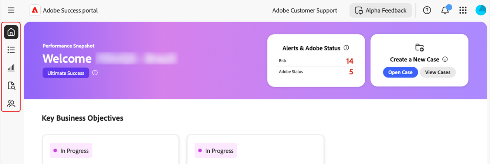
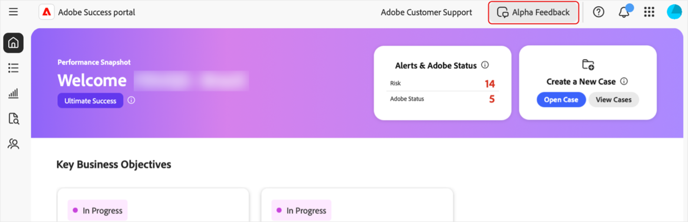

# Acceso al portal de [!DNL Adobe Success]

En esta guía se explica cómo iniciar sesión en el portal de [!DNL Adobe Success] y recibir ayuda si se tiene problemas para acceder.

Recibirá una notificación del equipo del portal de **[!UICONTROL Success]** que confirma su acceso. Este mensaje incluye los detalles de inicio de sesión.

1. Vaya a [https://experience.adobe.com/](https://experience.adobe.com/).
1. Inicie sesión con su Adobe ID.
1. Seleccione el icono **[!UICONTROL portal de Success (Alpha)]**.

   ")

1. Una vez que haya iniciado sesión, verá cinco pestañas:

   

   * Inicio
   * **[!UICONTROL Plan de acción]**
   * **[!UICONTROL Rastreador de valores]**
   * **[!UICONTROL Asistencia y datos]**
   * **[!UICONTROL Plan de participación de asistencia]**

## Solución de problemas y asistencia

Si tiene problemas para acceder al portal o a sus funciones, contacte con nuestro equipo mediante el [canal de Teams Alpha](https://teams.microsoft.com/l/channel/19:h-GcuAZs9uF05rervqTdx2U27ohYINuRUIfbMte9B-U1@thread.tacv2/General?groupId=02b87789-3475-47e4-94c1-0981f63ae89f&tenantId=fa7b1b5a-7b34-4387-94ae-d2c178decee1).   

Puedes usar el botón **[!UICONTROL Comentarios de Alpha]** del portal para enviar comentarios.

>[!NOTE]
>
>La herramienta de comentarios no es un canal de asistencia específico. No es adecuada para problemas de inicio de sesión urgentes.

